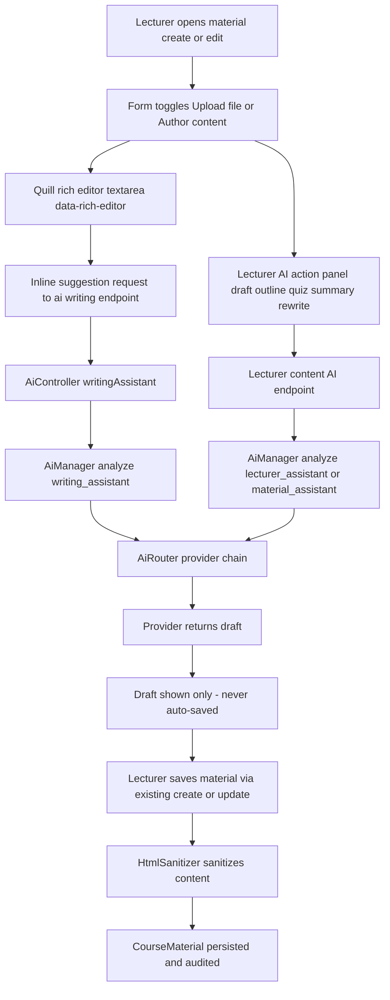

# AcadFlow Course Material + Lecturer AI Enhancement Plan

## Goal

Extend the AcadFlow course system so lecturers can:

1. Edit uploaded course materials directly in the system.
2. Author course materials natively with a high-quality rich editor (no file required).
3. Use the existing central AI assistant for suggestions, content generation and editing support.
4. Run advisory automation for content generation and grading assistance.
5. Keep everything permission-aware, human-in-the-loop, audited, and fully tested.

## Confirmed approach

Advisory-only, minimal new dependencies, reuse of the existing central AI runtime:

- Wire the existing Quill rich editor ([`resources/js/rich-editor.js`](../resources/js/rich-editor.js)) into material create/edit.
- Add inline authored content (sanitized HTML) stored alongside optional file uploads.
- Add a Lecturer AI action panel (draft, outline, quiz, summary, rewrite) that routes through [`AiManager`](../app/Ai/AiManager.php).
- Automation never writes autonomously. Every AI output is a draft the lecturer must explicitly save or apply, and each apply action is audited.

## Current state (verified)

- [`course_materials` migration](../database/migrations/2026_04_21_000000_create_course_materials_tables.php:11) is file-only. `file_name` and `file_path` are NOT NULL, and there is no content column.
- [`CourseMaterialController`](../app/Http/Controllers/CourseMaterialController.php:130) only supports file upload on store and metadata-only edits on update.
- [`resources/views/materials/lecturer-create.blade.php`](../resources/views/materials/lecturer-create.blade.php:1) and [`resources/views/materials/edit.blade.php`](../resources/views/materials/edit.blade.php:1) are plain upload forms with a textarea description and no rich editor.
- The Quill rich editor already exists and wires AI suggestions through `data-ai-url`, `data-ai-enabled` and `data-ai-min-chars` in [`initQuill()`](../resources/js/rich-editor.js:244).
- [`AiController::writingAssistant()`](../app/Http/Controllers/AiController.php:680) already exposes `/ai/writing` for inline editor suggestions.
- The contextual [`material_assistant`](../app/Services/Ai/ContextualAssistantService.php:286) already answers questions about a material on the show page via [`_contextual-assistant.blade.php`](../resources/views/ai/_contextual-assistant.blade.php:1).
- Manual grading uses [`SubmissionController::grade()`](../app/Http/Controllers/SubmissionController.php:609) and [`GradeSubmissionAction`](../app/Actions/Submission/GradeSubmissionAction.php:14).
- Provider config is centralized in [`AiRuntimeConfigService`](../app/Services/Ai/AiRuntimeConfigService.php:33) and routed by feature keys in [`config/ai.php`](../config/ai.php:72).

## Key design decisions

- Reuse existing AI feature keys instead of adding new ones, to avoid prompt-baseline migrations and keep AI Settings authoritative:
    - Lecturer content generation and editing: `lecturer_assistant` and `material_assistant`.
    - Grading assistance: `submission_validator` (advisory only).
    - Inline editor suggestions: `writing_assistant` via `/ai/writing`.
- Add a first-party HTML sanitizer (allowlist) to avoid a new composer dependency and to harden authored content against XSS.
- Store authored content as sanitized HTML in `content`, with `content_format` fixed to `html`.
- Generated AI content is never persisted by generation endpoints. Persistence happens only through existing create/update/grade actions or a dedicated explicit apply endpoint, and is audit-logged.

## Data model changes

New nullable columns on `course_materials`:

- `content` longText nullable - sanitized HTML authored in-system.
- `content_format` string default `html`.
- `source` string default `upload` with values `upload`, `authored`, `ai_assisted`.
- `content_updated_at` timestamp nullable.

Existing columns made nullable so authored materials need no file:

- `file_name`, `file_path`.

## Request lifecycle (authored material + AI)

## Implementation phases

### Phase A - Data and model foundation

- Add migration for `content`, `content_format`, `source`, `content_updated_at`, and make `file_name` / `file_path` nullable.
- Update [`CourseMaterial`](../app/Models/CourseMaterial.php:11) fillable and casts, plus `hasFile()` and `hasContent()` helpers.

### Phase B - Sanitizer and controller support

- Add `App\Support\HtmlSanitizer` with a conservative allowlist: permitted tags, permitted attributes, and URL scheme filtering. Strip `script`, `style`, event handlers, and `javascript:` URLs.
- Extend [`CourseMaterialController`](../app/Http/Controllers/CourseMaterialController.php:130) store/update to accept file OR content, sanitize authored HTML, set `source`, and keep file security scanning for uploads.
- Render authored content safely in [`materials/show.blade.php`](../resources/views/materials/show.blade.php:1) using the already-sanitized HTML.

### Phase C - Views and editor wiring

- Update [`lecturer-create.blade.php`](../resources/views/materials/lecturer-create.blade.php:1) and [`edit.blade.php`](../resources/views/materials/edit.blade.php:1): mode toggle (upload vs author), rich editor textarea with `data-rich-editor`, and AI suggestion attributes pointing to `/ai/writing`.
- Add a Lecturer AI action panel partial with quick actions (Draft section, Outline, Quiz, Summary, Rewrite, Improve tone) that call the new lecturer content endpoint and insert drafted text into the editor only after the lecturer confirms.
- Update [`materials/index.blade.php`](../resources/views/materials/index.blade.php:1) and [`courses/show.blade.php`](../resources/views/courses/show.blade.php:1) to reflect authored materials.

### Phase D - Lecturer AI assistance endpoints

- Add a `LecturerContentAssistantController` with:
    - `POST /lecturer/courses/{course}/ai/content` for action-based generation.
    - `POST /lecturer/courses/{course}/materials/{material}/ai` for material-scoped generation and editing.
- Authorize with [`CourseMaterialPolicy`](../app/Policies/CourseMaterialPolicy.php:36) create/update plus course access, gate behind the `ai_assistant` feature flag, and apply `throttle:ai`.
- Build payloads with course/material context and the selected text via the central [`AiManager`](../app/Ai/AiManager.php:44) using `lecturer_assistant` and `material_assistant`. Return drafts only.

### Phase E - Advisory automation

- Add `CurriculumAutomationService` for: quiz bank generation, outline and topic structure, study questions, and material summaries. All return suggestions only.
- Add `SubmissionGradingAssistantService` that uses `submission_validator` to produce a suggested score and feedback from the rubric and submission. It never changes the grade.
- Provide explicit apply steps only where the user confirms:
    - Apply AI draft into a new or existing material through the existing store/update.
    - Apply suggested grade through the existing [`SubmissionController::grade()`](../app/Http/Controllers/SubmissionController.php:609) after the lecturer reviews.
- Audit every generation and apply action with `AuditLog`.

### Phase F - Security, flags, logging

- Reuse the `ai_assistant` feature flag. If a dedicated flag is preferred, add `course_ai_authoring` (disabled by default) in [`config/features.php`](../config/features.php:295).
- Ensure all generated content is treated as a draft, is sanitized on persist, and is escaped on render.
- Rate-limit and log AI endpoints, and never log secrets or full prompts.

### Phase G - Tests and validation

- Feature tests for authored material CRUD and policies.
- Unit tests for `HtmlSanitizer` (script stripping, event handler removal, safe tags preserved).
- Feature tests for lecturer AI content endpoints with a mocked `AiManager` (no live provider calls).
- Tests proving automation endpoints perform no writes, and apply endpoints persist and audit.
- Tests proving grading assistance does not change the grade until applied.
- Regression tests that existing file-upload material flow and existing AI assistant endpoints still pass.

## Validation commands

- `php artisan migrate`
- `php artisan optimize:clear`, `php artisan view:clear`, `php artisan route:clear`, `php artisan config:clear`
- `php artisan route:list --path=lecturer/courses`
- `php -l` on changed Blade views
- `php artisan test --filter='(CourseMaterial|HtmlSanitizer|LecturerContentAssistant|CurriculumAutomation|GradingAssistant|AiAssistant|OpenRouterProvider)'`
- `npm run build`

## Risks and mitigations

- Authored HTML XSS: mitigated by allowlist sanitizer on save and safe rendering.
- Provider timeouts seen in `ai-provider-2026-10-14.log`: mitigated by advisory async-friendly UX, retry affordances, and tests that mock the provider so the suite never depends on live calls.
- Accidental autonomous writes: mitigated by generation endpoints returning drafts only, explicit apply endpoints, and audit logs.
- File/`content` nullability change: mitigated by a reversible migration and keeping existing upload behavior intact.
