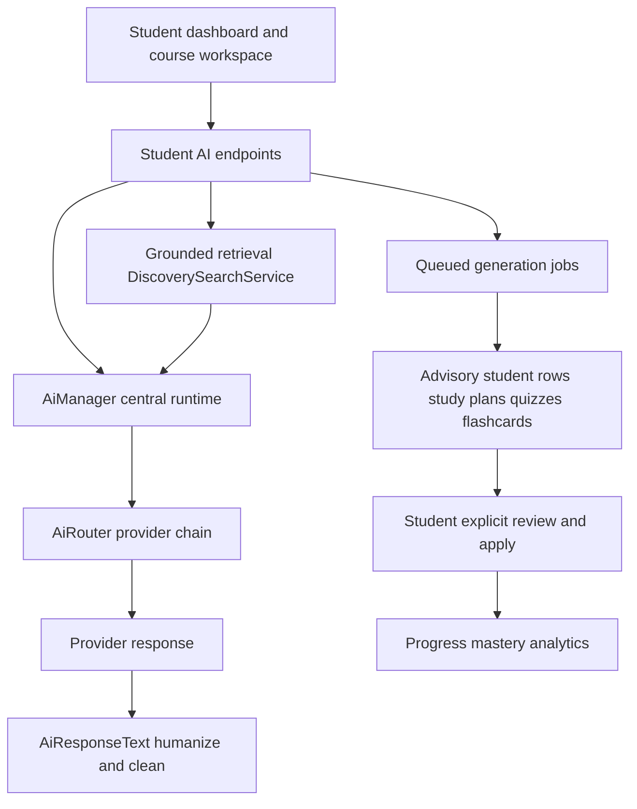

# AcadFlow Student Experience: AI Feature Upgrade Proposal

## Purpose

Propose a detailed set of student-facing features and upgrades that build directly on the AI foundations already delivered for lecturers: central AI routing, contextual assistants, advisory draft automation, JSON-to-readable response humanization, queued background jobs, and allowlist HTML sanitization.

Each feature below follows the same template:

- What it is
- The student problem it solves
- How it fits the current Laravel architecture, including AI integration
- Priority ranking with rough impact versus effort

## What students have today verified

- Student dashboard with enrolled courses, pending deadlines, submissions, CGPA and a coarse course progress ring in [`DashboardController::student()`](acadflow-web/app/Http/Controllers/DashboardController.php:28) and [`dashboard/student.blade.php`](acadflow-web/resources/views/dashboard/student.blade.php:1).
- Course list and course workspace in [`courses/index.blade.php`](acadflow-web/resources/views/courses/index.blade.php:1) and [`courses/show.blade.php`](acadflow-web/resources/views/courses/show.blade.php:1).
- Course materials with authored content and the material assistant in [`CourseMaterialController`](acadflow-web/app/Http/Controllers/CourseMaterialController.php:1).
- Study Assistant, Writing Assistant and Citation Assistant through [`AcademicAssistantService`](acadflow-web/app/Services/Ai/AcademicAssistantService.php:1).
- Contextual assistants including material, assignment, project, research and discussion in [`ContextualAssistantService`](acadflow-web/app/Services/Ai/ContextualAssistantService.php:1).
- AI response humanization in [`AiResponseText`](acadflow-web/app/Support/AiResponseText.php:1).
- Advisory queued draft automation pattern in [`GenerateLecturerContentDraft`](acadflow-web/app/Jobs/GenerateLecturerContentDraft.php:1) and [`AiContentDraft`](acadflow-web/app/Models/AiContentDraft.php:1).

Gaps confirmed by inspection: there is currently no persistent study plan, no stored practice quizzes or attempts, no flashcards or spaced repetition, no per-topic mastery tracking, and no student-scoped saved AI notes. The study assistant offers revision plan and practice question prompts but nothing persistent, adaptive or trackable.

## Design principles for student features

1. Reuse the central AI runtime. All generative calls route through [`AiManager`](acadflow-web/app/Ai/AiManager.php:44) and feature keys in [`config/ai.php`](acadflow-web/config/ai.php:72). No student feature selects a provider directly.
2. Reuse the draft automation pattern. Background generation writes advisory rows (like [`AiContentDraft`](acadflow-web/app/Models/AiContentDraft.php:1)) that a student explicitly acts on.
3. Reuse grounded retrieval. Student answers are grounded with [`DiscoverySearchService::relevantChunksForSubject()`](acadflow-web/app/Services/Discovery/DiscoverySearchService.php:65) scoped by course access.
4. Academic integrity first. Student tools scaffold learning and self-assessment; they do not produce ready-to-submit graded work. This mirrors the `study_assistant` and `assignment_assistant` guardrails.
5. Always humanize and sanitize. Reuse [`AiResponseText`](acadflow-web/app/Support/AiResponseText.php:1) and [`HtmlSanitizer`](acadflow-web/app/Support/HtmlSanitizer.php:1).
6. Feature-flag and permission-aware. New capabilities are registered in [`config/features.php`](acadflow-web/config/features.php:295) and enforced through [`FeatureAccessService`](acadflow-web/app/Services/FeatureAccessService.php:1).

## Proposed student AI layer

## Feature proposals

### 1. Personal Study Plan and Revision Scheduler

- What it is: A per-course, dated study plan generated from authorized material topics, assignment deadlines and the student's stated goals. It shows weekly focus topics, suggested study blocks and checkpoints, and can be regenerated or rescheduled.
- Student problem: Students know a course exists but not how to sequence their preparation; revision is reactive and cramming-based.
- Implementation: New tables `study_plans` and `study_plan_items`. A `StudyPlanService` builds context from [`CourseMaterial`](acadflow-web/app/Models/CourseMaterial.php:1) topics via the lecturer `courseContextFor` pattern, plus [`SubmissionTask`](acadflow-web/app/Models/SubmissionTask.php:1) deadlines, then calls [`AiManager`](acadflow-web/app/Ai/AiManager.php:44) under a new `study_planner` feature key. Generation runs through a queued job modeled on [`GenerateLecturerContentDraft`](acadflow-web/app/Jobs/GenerateLecturerContentDraft.php:1). A student controller under the existing student/lecturer route group exposes generate, list, adjust and complete-plan actions. Items integrate with the dashboard deadline widget in [`DashboardController::student()`](acadflow-web/app/Http/Controllers/DashboardController.php:28).
- Priority: P0. High impact on outcomes and engagement, medium effort because it reuses the draft-and-queue pattern.

### 2. Adaptive Practice Quiz and Question Bank

- What it is: Generate and store practice quizzes from authorized course materials, with multiple attempts, instant feedback, explanations, and difficulty that adapts to prior answers.
- Student problem: Limited practice opportunities before assessments; no safe place to fail and learn.
- Implementation: Tables `practice_quizzes`, `practice_questions`, `practice_attempts`, `practice_answers`. A `PracticeQuizService` uses [`ContextualAssistantService::material()`](acadflow-web/app/Services/Ai/ContextualAssistantService.php:286) context or course sources, generates items via a new `practice_generator` feature, validates structured JSON with [`AiResponseSchemaValidator`](acadflow-web/app/Services/Ai/AiResponseSchemaValidator.php:9) and humanizes with [`AiResponseText`](acadflow-web/app/Support/AiResponseText.php:1). A student UI renders quizzes and scores attempts. Adaptive selection is server-side difficulty weighting from stored attempt history.
- Priority: P0. Very high impact on outcomes, medium-high effort due to schema and attempt tracking.

### 3. Spaced-Repetition Flashcards

- What it is: Auto-generated flashcards from materials, scheduled with a spaced-repetition algorithm and a daily review queue with self-rated recall.
- Student problem: Students forget material between lectures and lack a lightweight retention habit.
- Implementation: Tables `flashcard_decks`, `flashcards`, `flashcard_reviews`. A `FlashcardService` generates cards using the `material_assistant` or a new `flashcard_generator` feature, then stores them as reviewable rows. Scheduling uses a simplified SM-2 in a service. The dashboard surfaces a daily due count. Generation can be queued like draft automation.
- Priority: P1. High impact on retention, medium effort, low-risk because cards are student-owned.

### 4. Grounded Course Companion with Saved Notes

- What it is: A persistent, course-scoped Q&A companion that cites authorized sources and lets students save helpful answers as notes, thread-style.
- Student problem: Help is scattered and answers are not retained or revisited.
- Implementation: Reuse [`AcademicAssistantService::ask()`](acadflow-web/app/Services/Ai/AcademicAssistantService.php:217) and the material assistant with course filtering, and add tables `study_conversations` and `study_notes`. A student controller persists threads and notes, reusing grounding and citation labels already produced. Rendering reuses the assistant panel pattern in [`ai/_contextual-assistant.blade.php`](acadflow-web/resources/views/ai/_contextual-assistant.blade.php:1).
- Priority: P0. High impact on usability, low-medium effort since the AI path already exists.

### 5. Topic Mastery and Learning Analytics for Students

- What it is: A student view of per-topic mastery inferred from practice attempts, flashcard recall, materials opened and assignment outcomes, with weak-area recommendations.
- Student problem: Students cannot see what they are weak at until grades arrive.
- Implementation: A `StudentMasteryService` aggregates stored data (practice attempts, flashcard reviews, material access logs, submissions) into a `topic_mastery` table keyed by course and topic. An optional AI narrative summary uses the `study_assistant` feature to explain weaknesses and suggest next steps. Extends the existing [`AcademicPerformanceService`](acadflow-web/app/Services/AcademicPerformanceService.php:1) and the dashboard progress ring.
- Priority: P1. High impact, medium effort; depends on features 2 and 3 for rich signals but is useful with existing data alone.

### 6. Socratic Study Mode and Hint Ladder

- What it is: A study assistant mode that guides with questions and progressive hints instead of giving final answers, with guided step-by-step scaffolding.
- Student problem: Students over-rely on direct answers, which undermines learning and risks integrity issues.
- Implementation: A new `study_mode` parameter on the study assistant flow, plus a dedicated instruction profile and optional `socratic_tutor` feature key. Implemented in [`AcademicAssistantService`](acadflow-web/app/Services/Ai/AcademicAssistantService.php:1) by adding an instruction variant and a mode selector in the assistant UI. No new persistence required.
- Priority: P0. High impact on outcomes and integrity, low effort because it is prompt and UI level.

### 7. Material Annotation, Highlights and Study Notes

- What it is: Highlight text and add margin notes in authored and file-based materials, then auto-generate a summary and export a study note.
- Student problem: Passive reading; no easy way to capture and revisit key points.
- Implementation: Tables `material_annotations` and `material_notes`. Highlight and note UI in [`materials/show.blade.php`](acadflow-web/resources/views/materials/show.blade.php:1). AI summarization of highlights uses the `material_assistant` feature and [`AiResponseText`](acadflow-web/app/Support/AiResponseText.php:1). Export reuses [`ExportController`](acadflow-web/app/Http/Controllers/ExportController.php:1) patterns.
- Priority: P1. Medium-high impact, medium effort.

### 8. Personalized Learning Profile

- What it is: Student-set learning preferences such as pace, background level, preferred explanation style, language and reading level that tailor AI prompts.
- Student problem: Generic explanations do not match individual prior knowledge.
- Implementation: Add a `learning_profile` JSON column on users or a `student_learning_profiles` table. Inject the profile into payloads in [`AcademicAssistantService`](acadflow-web/app/Services/Ai/AcademicAssistantService.php:1) and [`ContextualAssistantService`](acadflow-web/app/Services/Ai/ContextualAssistantService.php:1). A settings screen under the existing onboarding or account area manages it.
- Priority: P0. High impact on personalization, low effort.

### 9. AI-Facilitated Study Groups

- What it is: Course or topic study groups where AI summarizes discussions, generates practice prompts, and lists unresolved questions.
- Student problem: Group study is unstructured and dominated by a few voices.
- Implementation: Reuse the existing Groups module and [`ContextualAssistantService::discussion()`](acadflow-web/app/Services/Ai/ContextualAssistantService.php:315). Add a group-scoped AI panel and optional saved group summaries. Reuses `discussion_assistant`.
- Priority: P2. Medium impact, medium effort; depends on current engagement features being used.

### 10. Proactive Deadline Coach

- What it is: Timely, personalized nudges that turn upcoming deadlines into an ordered AI-assisted action plan and reflection after submission.
- Student problem: Missed and rushed deadlines.
- Implementation: Leverage the existing scheduler and notification stack ([`NotificationService`](acadflow-web/app/Services/NotificationService.php:1) and `DeadlineApproaching` event). A scheduled command generates a short AI plan via the `study_planner` feature and stores it for the dashboard.
- Priority: P1. Medium impact, low-medium effort given scheduler and notifications already exist.

### 11. Accessibility and Language Support

- What it is: One-tap explanation simplify, translate to a preferred language, adjust reading level, and consistent offline access through the existing PWA.
- Student problem: Accessibility and second-language barriers reduce comprehension.
- Implementation: Add `simplify` and `translate` actions reusing the humanized text pipeline and the `material_assistant` or `study_assistant` feature. UI controls in the assistant panel and material view. No heavy new infrastructure.
- Priority: P1. High inclusion impact, low effort because it is prompt plus UI.

### 12. Self-Assessment Against Rubrics

- What it is: Students run a structured self-check against the assignment rubric before submitting, producing a confidence checklist and improvement suggestions.
- Student problem: Misjudging readiness and avoidable mark loss.
- Implementation: Extend [`ContextualAssistantService::assignment()`](acadflow-web/app/Services/Ai/ContextualAssistantService.php:112) with a persisted `self_assessments` table and a pre-submit UI in the assignment view. Advisory only, consistent with integrity guardrails.
- Priority: P1. High impact on quality, medium effort.

### 13. Exam Readiness Estimator

- What it is: An advisory readiness indicator per course based on mastery, practice performance, deadline completion and study consistency.
- Student problem: Uncertainty about exam preparedness.
- Implementation: A `ReadinessService` computes a deterministic score from stored signals (no provider needed) and an optional AI narrative via the `study_assistant` feature. Surfaced on the student dashboard.
- Priority: P2. Medium impact, low-medium effort; depends on features 2, 3 and 5.

### 14. Metacognitive Reflection Journal

- What it is: Short guided reflections after study sessions and assessments, with AI feedback on study strategy.
- Student problem: Students do not adjust study strategies that are not working.
- Implementation: `study_reflections` table plus prompts in the dashboard. AI feedback uses `study_assistant`. Low risk, reuses the humanized text pipeline.
- Priority: P2. Medium impact, low effort.

## Priority summary

| Priority | Features                                                                                                  | Rationale                                                                                                  |
| -------- | --------------------------------------------------------------------------------------------------------- | ---------------------------------------------------------------------------------------------------------- |
| P0       | 1 Study Plan, 2 Practice Quiz Bank, 4 Grounded Companion with Notes, 6 Socratic Mode, 8 Learning Profile  | Highest impact on learning outcomes, engagement and personalization with strong reuse of existing AI paths |
| P1       | 3 Flashcards, 5 Mastery Analytics, 7 Annotations, 10 Deadline Coach, 11 Accessibility, 12 Self-Assessment | High impact, mostly medium effort, build on P0 data                                                        |
| P2       | 9 Study Groups, 13 Readiness Estimator, 14 Reflection Journal                                             | Valuable but dependent or lower urgency                                                                    |

## Cross-cutting implementation notes

- New AI feature keys must be added to [`config/ai.php`](acadflow-web/config/ai.php:72) and given prompt baselines in a migration like [`2026_08_15_121000_ensure_ai_feature_prompt_baselines.php`](acadflow-web/database/migrations/2026_08_15_121000_ensure_ai_feature_prompt_baselines.php:1) so AI Settings remains authoritative.
- Generation endpoints should follow the advisory-only contract: background generation writes drafts, and persistence into student records happens only on explicit student action, with audit logging via [`AuditLog`](acadflow-web/app/Models/AuditLog.php:44).
- Ground all course-specific answers with [`DiscoverySearchService`](acadflow-web/app/Services/Discovery/DiscoverySearchService.php:1) and enforce course access with [`User::canAccessCourse()`](acadflow-web/app/Models/User.php:82).
- Reuse [`AiResponseText::humanizeJson()`](acadflow-web/app/Support/AiResponseText.php:75) so structured AI outputs render as readable text in every new student surface.
- Register each capability in [`config/features.php`](acadflow-web/config/features.php:295) and gate routes with `feature.flag` and `ai.feature` middleware plus `throttle:ai`.

## Suggested phased roadmap

1. Phase 1 (foundation): Feature 8 Learning Profile, Feature 6 Socratic Mode, Feature 4 Grounded Companion with Notes.
2. Phase 2 (practice and retention): Feature 2 Practice Quiz Bank, Feature 3 Flashcards, Feature 1 Study Plan.
3. Phase 3 (insight): Feature 5 Mastery Analytics, Feature 12 Self-Assessment, Feature 10 Deadline Coach, Feature 11 Accessibility.
4. Phase 4 (extensions): Feature 7 Annotations, Feature 13 Readiness Estimator, Feature 14 Reflection Journal, Feature 9 Study Groups.

## Risks and mitigations

- Academic integrity: keep all student tools scaffold and self-assessment oriented; never generate ready-to-submit graded work. Mitigation: explicit instruction profiles and review of the `study_assistant` and `assignment_assistant` guardrails.
- Provider cost and latency: avoid unnecessary generation by caching and queuing, and reuse [`AiCache`](acadflow-web/app/Ai/AiCache.php:1). Mitigation: background jobs and the advisory draft model.
- Data privacy: student-generated data is per-user and course-scoped. Mitigation: policies and the existing tenant scoping.
- Content safety: sanitize all student-authored and AI content with [`HtmlSanitizer`](acadflow-web/app/Support/HtmlSanitizer.php:1).
